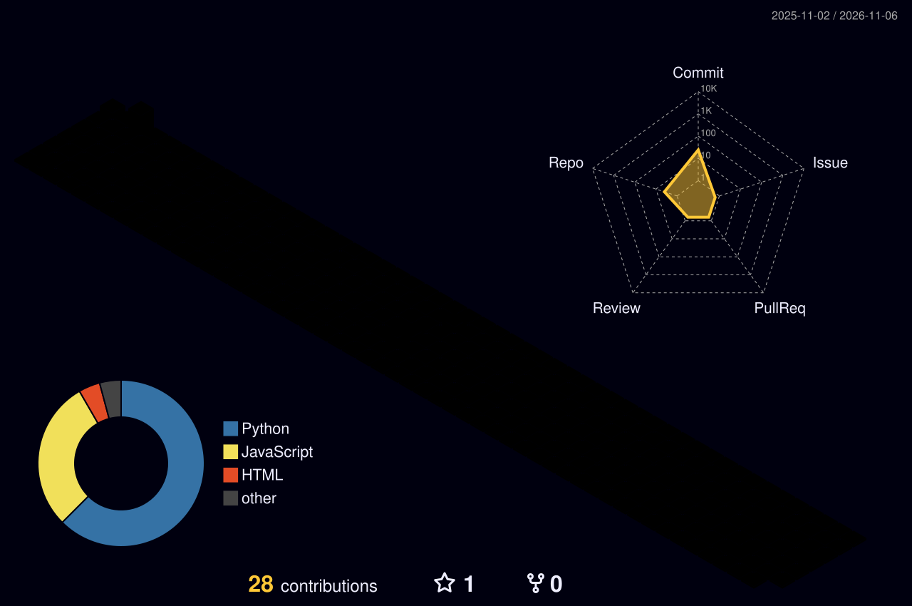

<!-- ═══════════════════ RAJESH KUMAR JHA · GITHUB PROFILE ═══════════════════ -->

<div align="center">
  
</div>

<div align="center">
  
</div>

<div align="center">
  <a href="https://github.com/404rajesh"></a>
  <a href="https://www.linkedin.com/in/404rajesh"></a>
  <a href="mailto:mail.404rajesh@gmail.com"></a>
  
</div>

<br/>

## 🧑‍💻 About Me

```python
class RajeshKumarJha:
    role       = "Executive-Technical (AI/ML) — R&D"
    education  = "B.Tech, AI & Data Science — GGSIPU, Delhi (2022–2026)"
    location   = "Delhi, India 🇮🇳"
    focus      = ["Computer Vision", "Deep Learning", "Detection Systems"]
    currently  = "Building production AI/ML inspection & detection systems"
    motto      = "A model that never ships is just an experiment."
```

- 🔭 Working in **R&D** on real-world **computer vision** systems — detection, inspection and deployment
- 🎓 Final-year **B.Tech (AI & Data Science)** at GGSIPU, Delhi
- 🧠 I care about the full pipeline: **data → training → evaluation → FastAPI deployment**
- 📫 Reach me at **mail.404rajesh@gmail.com**

<br/>

## 🛠️ Tech Arsenal

<div align="center">
  
  <br/>
  
  <br/>
  
</div>

<p align="center">
  <b>Core:</b> Python · PyTorch · TensorFlow · YOLOv8 · OpenCV · scikit-learn<br/>
  <b>Ship:</b> FastAPI · Node.js · React / Next.js · PostgreSQL · REST APIs · Docker · Linux
</p>

<br/>

## 🚀 Featured Projects

<table>
<tr>
<td width="50%" valign="top">

### 👁️ Diabetic Retinopathy Detection
**EfficientNet-B3** grading of retinal fundus images with explainability built in.

- 🎯 **QWK 0.8649** · **~82.9% accuracy**
- ✅ 5-fold stratified validation
- 🔍 **Grad-CAM** visual explanations
- 🌐 Streamlit app

**[→ View Repository](https://github.com/404rajesh/Diabetic-Retinopathy-Detection)**

`Python` `EfficientNet-B3` `Grad-CAM` `Streamlit`

</td>
<td width="50%" valign="top">

### 🦺 AI-Based PPE Compliance Detection System
Real-time **11-class PPE detection** (helmet, gloves, vest, boots, goggles…) for workplace safety.

- 🎯 **mAP@50 — 0.880** person · **0.850** vest · **0.806** helmet
- ⚡ **~23.5 ms/frame** inference
- 🌐 FastAPI + PostgreSQL backend

**[→ View Repository](https://github.com/404rajesh/ppe-detection-system)**

`YOLOv8` `FastAPI` `PostgreSQL` `Computer Vision`

</td>
</tr>
</table>

### 📂 More Builds

| Project | What it is | Stack |
|---|---|---|
| **[skillshare-hub](https://github.com/404rajesh/skillshare-hub)** | Skill-sharing platform backend | Go |
| **[Student-Attendance-System](https://github.com/404rajesh/Student-Attendance-System)** | QR + location-based attendance | JavaScript |
| **[go-bookstore](https://github.com/404rajesh/go-bookstore)** | Bookstore REST API | Go · GORM |

<br/>

## 📊 GitHub in 3D

<div align="center">
  
</div>

> ☝️ This 3D contribution city is **generated automatically** by the GitHub Action in this repo (`.github/workflows/profile-3d.yml`) — it rebuilds itself daily.

<div align="center">
  
  
</div>

<div align="center">
  
</div>

<div align="center">
  
</div>

<br/>

## 🐍 Watch the Snake Eat My Contributions

<div align="center">
  
</div>

<br/>

<div align="center">
  
</div>

<div align="center">
  <i>⭐ If something here helped you, a star on the repo means a lot.</i>
</div>
